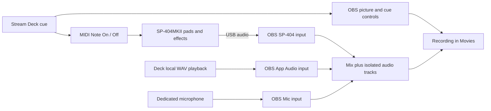

# Recording performance: OBS, Stream Deck, and SP-404MKII

Research and implementation sequence, 2026-09-08.
Writer: the deck maintainer. Readers: Ryan and the next implementation session.
If wrong: we build unavailable controls, lose audio when changing shots, or repeat work already done.

## Recommendation

Build a small set of **performance cues**: each press has a recognizable purpose
in the video. Start with reaction framing, a takeaway banner, a topic transition,
signature sounds, and a return-to-normal control. Keep the existing quick-record
workflow. Use the SP's pads for expressive sound performance and the deck for
coordinated picture-and-sound cues.

The creative starting assumption is clear screen demonstrations with occasional
playful reactions. This is a proposed direction, not a recorded style decision.
The user has explicitly resumed OBS production-value and SP soundboard work;
the September 2 deferral is no longer a reason to leave those areas untouched.

**Success means useful recordings, not every key occupied.** The existing dark
gutter is a deliberate tactile landmark. Preserve it while the new controls earn
their positions through use.

Evidence labels: **LOCAL** = inspected on this Mac today; **HISTORY** = previously
exercised in this repo; **SOURCE** = vendor/maintainer documentation; **PROPOSED** =
design or chosen starting value; **UNTESTED** = still needs real output or hardware.
Installed/configured is not the same as tested by pressing a key.

## What already exists, and what drifted

| Area | Evidence | Consequence |
|---|---|---|
| XL and SD+ | LOCAL: layout owns both; `node scripts/check-deck.mjs` checked 10 stored pages, 23 shipped actions, all reachable | Extend the existing layout and plugin identity. Do not hand-edit the main profile. |
| Move transition | LOCAL: Move 3.2.1 installed; Control Room selects Move at 350 ms. HISTORY: installed and exercised Sept 3 | Camera sliding is already available. The README's old install task is stale. |
| Camera ISO | LOCAL: Source Record filter on Camera. HISTORY: separate camera + mic MP4 verified Sept 3 | Preserve the clean camera recording when adding presentation effects. |
| Audio dials | LOCAL: Mic / SP-404 / App Audio in `ENCODERS` | The SD+ already supplies the mixer controls. |
| Sampler | LOCAL: CoreAudio enumerates SP-404MKII-IN and SP-404MKII-OUT, 48 kHz; SP is the default Mac audio output | This is the MKII. USB audio is already connected. MIDI mode, firmware and occupied pads remain unmeasured. |
| Recording tracks | LOCAL: advanced output enables tracks 1–4; shared inputs route mix + isolated mic/SP/apps | Keep a playable mix on 1, mic on 2, SP on 3, apps on 4. |
| Audio scene coverage | LOCAL, before repair: Me + Float has Mic but no SP/App Audio; Cam Cutout contains only Camera FX | Sound cues cannot be considered ready across camera looks. Repair and exercise coverage first. |
| Frame rate | LOCAL: saved profile initially suggested 24 fps; after launch, `GetVideoSettings` reports 30/1 fps | Live OBS resolves the discrepancy: author against 30 fps and recheck at export. Recording cadence was not changed. |
| Replay | LOCAL: `AdvOut.RecRB=false`, stored duration 20 s | Save-last-moment is a new feature, not an existing working button. |
| Elgato OBS plugin | LOCAL, corrected later the same day: `com.elgato.obsstudio.sdPlugin` IS in the Stream Deck plugins directory, and a hand-placed "Scene Transition" key from it sat on XL key 4,1 (found when the REACT layout write replaced it) | The stock actions are available for reuse. How the earlier "not found" row was produced is not known; what is observed is that the plugin is present now. |
| Ableton/MIDI deck plugins | LOCAL: no Trevligaspel MIDI or the previously named Ableton loader found in that directory | Verify current installation before making either a dependency. |
| SP library | LOCAL: sibling `ABLETON/blessdog/phase8_sp404` has conversion, provenance, staging and transfer code | Reuse that library owner. Do not start a second sample database in OBS. |

The audit started with OBS closed. Saved configuration findings above are not
claims about current audio quality or physical button operation.

### First implementation completed in this session

`obs/setup-audio.mjs` now includes Cam Cutout in speaking-scene repair, adds
missing Mic as well as SP/App inputs, checks the collection and active recording/
stream before writing, and fails verification for missing or disabled audio
placements. Its websocket connection closes on failure as well as success.

Applied additively: three shared audio items in Cam Cutout, two in Me + Float.
A second dry run proposed no further scene additions. Starting Soon and Ending
retain their original source lists. All eight speaking scenes have the three
enabled shared inputs. This does not create new capture-device instances.

The recording exercise visited Cam, Cam Cutout, Me + Float and Lava Lounge and
played a quiet system test sound in each. The resulting H.264 MP4 has four AAC
audio tracks; the App Audio track has signal in all four measured intervals
(-33.6, -33.5, -27.7 and -33.6 dB peak). Shared audio sources reported active in
each look. This proves recorded app-audio coverage, not equal loudness, visual
quality, latency, or sampler-pad identity. Physical SP hits and spoken-mic
isolation still require an audition. No physical key test is claimed.

Evidence: [before](../evidence/2026-09-08/audio-coverage-before.json),
[after, including exact inserted item IDs](../evidence/2026-09-08/audio-coverage-after.json),
[repair output](../evidence/2026-09-08/audio-setup.txt),
[recording check and exact OBS-returned path](../evidence/2026-09-08/audio-recording-check.json).
The test recording is retained; no recordings were deleted. The previous program
scene was restored after the exercise.

### Order 1 built: REACT + NORMAL (later on 2026-09-08)

Installed, machine-verified, and waiting for Ryan's press. `plugin/src/cues.ts`
holds the one saved shot and transition that any cue must give back;
`actions/react.ts` is a momentary key (key-down captures and switches, key-up
restores only if the program is still on React, and awaits the key-down
round-trip so a fast tap cannot strand the close-up); `actions/normal.ts`
restores whatever the cue holds and is lit only while a cue is live. The React
scene is `obs/add-look.mjs react`: the shared Camera at 1.4x (CHOSEN, not
measured — Center Stage upscale costs sharpness, his eyes decide) with
Mic/SP-404/App Audio placed by the builder. Keys sit at 4,1 and 5,1, directly
above CAM and CUTOUT.

Machine-verified: plugin builds; `check-deck.mjs` green (25 actions, all
reachable, all with VERIFY sentences); the scene has Camera, Mic, SP-404, App
Audio; `setup-audio.mjs --dry-run` lists React among nine speaking scenes and
proposes nothing; program was Screen L before and after the snapshot pass.
Evidence: [Cam](../evidence/2026-09-08/react-cam.png) and
[React](../evidence/2026-09-08/react-react.png), same camera, nobody in frame.

Not yet proven, only a press can: hold/release timing under the 350 ms Move; a
release before the transition finishes; scene key during a hold; recording
staying active across a reaction. Prior art searched first: the official Elgato
OBS plugin has no hold-to-switch, OBS hotkeys are toggles only, and Advanced
Scene Switcher can do it through a keyboard hotkey macro with no key-face state.

## What the controls would actually do

| Cue | Moment in a recording | Proposed behavior | Implementation route |
|---|---|---|---|
| **REACT** | Something surprising happens | Hold for a closer camera shot; release returns to the previous shot | Scene using the shared camera; Move for normal motion, Cut for a deliberate comic snap |
| **POINT** | Explain a detail | Existing native macOS zoom; add cursor highlighting/annotation only after checking capture | Keep the working Zoom keys; camera reaction framing is a separate operation |
| **TAKEAWAY** | State the main lesson | A short lower banner, with text prepared before the take, then automatic dismissal | OBS media/source controls; design a reusable overlay asset |
| **CHAPTER** | Change subject | One brief signature wipe with a restrained sound, plus a recording marker | OBS Stinger transition; marker only when recording; target scene part of the cue |
| **WIN / OOPS / THINK** | A result lands or something fails | A recognizable short sound; optionally one matching visual gesture | SP pad, or native Stream Deck Soundboard for a local WAV |
| **NORMAL** | Finish a reaction or recover | Cancel pending cue work, hide temporary overlays, restore the saved normal shot and transition | Explicit state restoration in the existing plugin |
| **SFX STOP** | A sample loops or a cue overlaps | Immediately silence the effects path, then stop owned players/held notes | Known-source mute first; sampler stop semantics must be tested |
| **SAVE LAST** | Something happened before Record | Save a proposed 30-second buffer to Movies and reveal the exact returned file | OBS Replay Buffer; arm explicitly and display real armed state |

These are proposals, not keys installed by this report. Suggested cue durations
are chosen creative starting points: camera move 200–350 ms, chapter sting
roughly 0.5–0.8 s, banner hold about 4 s. Tune by watching a finished take.
Use a chapter sting for a subject change; use ordinary cuts/moves for routine
shot changes. No evidence here attributes a particular setup to a named streamer.

A practical 60-second demonstration: start Screen + Cam; zoom a detail; show the
result; hold REACT and hit WIN; release; show TAKEAWAY; finish with a marker.
This makes the controls part of speaking rather than another interface to manage.

## Three different visual tools

**Scene transition:** changes the whole shot. Move matches sources across scenes
and animates their geometry. Matching transformation/bounding-box conventions
matter. Its Move Source filter also supports movement within a scene. This fits
the shared-camera design and saves us writing a frame-by-frame animation engine.
SOURCE: [Move, maintained by Exeldro](https://obsproject.com/forum/resources/move.913/).

**Stinger:** plays a short video over a scene change. The cut belongs at the frame
where the picture is covered. A track matte can reveal the new shot through an
animated mask. Begin with one simple wipe; verify first/last-frame transparency,
cut timing and sound sync. An ordinary opaque MP4 is not a transparent overlay.
SOURCE: [Elgato stinger guide](https://docs.elgato.com/obs/transitions/stinger-transitions/),
[track matte guide](https://docs.elgato.com/obs/transitions/track-matte-transitions/).

**Overlay/reaction:** adds a banner, stamp, border or animation over the current
shot. Keep one shared overlay scene/source across the supported speaking scenes.
Replay must restart reliably and clear on completion. A browser animation and an
OBS stinger are different delivery mechanisms; export and test the actual OBS
asset rather than assuming an HTML preview proves the video works.

Custom motion assets should use the available HyperFrames workflow when authored.
That asset authoring step does not replace OBS or the existing deck plugin.

## Tools: use the smallest proven set

| Tool | Fit for this rig | Decision |
|---|---|---|
| Existing Control Room plugin + OBS websocket | Already owns state feedback, cold start, layout and recorder behavior | Keep; add only coordination and recovery that the cues require |
| OBS built-ins | Media sources, stingers, filters, audio tracks, replay buffer | First choice for their respective jobs |
| Move | macOS supported; installed here | Use for geometry animation; no replacement tween engine |
| Native Stream Deck Soundboard | File playback modes and level controls are documented | Quick local-WAV option; exercise capture through App Audio on this Mac |
| Official Elgato OBS actions | Free, macOS support; scene/audio/record/media controls | Reuse when a stock action fully solves a cue; verify action package availability first |
| Trevligaspel MIDI | Mac/Windows support and Note On/Off documented by maintainer | Evaluate for deck → SP note triggers before writing a MIDI bridge |
| Advanced Scene Switcher | Maintainer supplies macOS builds; MIDI conditions exist | Candidate for SP pad → visual actions and event-driven auto-clear; add only when this behavior is needed |
| Ableton | Existing music/library lane | Preparation, loops, clip launching, more elaborate music sets; avoid making a simple SP hit require a DAW session |
| BarRaider OBS Tools | Marketplace lists Windows | Useful feature reference; does not fit this Mac as the implementation |
| Bitfocus Companion | Retired here after measured configuration failures | Keep the existing direct plugin architecture |

Sources: [Elgato Soundboard](https://www.elgato.com/us/en/explorer/products/stream-deck/how-to-set-up-a-soundboard/),
[official OBS action plugin](https://www.elgato.com/us/en/s/obs-studio-plugin-for-stream-deck),
[Trevligaspel MIDI](https://trevligaspel.se/streamdeck/midi/),
[MIDI plugin platform history](https://trevligaspel.se/streamdeck/midi/index.php/miscellaneous/version-history),
[Advanced Scene Switcher](https://github.com/WarmUpTill/SceneSwitcher),
[maintainer's MIDI condition definitions](https://github.com/WarmUpTill/SceneSwitcher/blob/master/data/locale/en-US.ini),
[BarRaider platform listing](https://marketplace.elgato.com/product/obs-tools-1736515e-1452-41a3-9548-d2b3a689076f).

## SP-404: sound performance and synchronized cues

The USB audio connection is present. The deck-to-MIDI arrow is proposed.
MIDI carries the instruction to play; the SP's USB audio carries the sound.
Physical pads can play the sound without a deck MIDI connection.

**Stage 1: curate a recording bank.** Use original spoken tags, a success hit,
a failure hit, a thinking loop, a short whoosh, and a few musical accents.
Choose samples by purpose and consistent perceived level, not by filling pads.
Keep origin/use-rights with the existing sample ledger. Do not reuse music stems
as publication-ready sound effects merely because they are in the library.

Use one-shot settings for short hits and deliberately chosen gate/loop behavior
for sustained sounds. Test retriggering and stopping before coordinating visuals.
Audition through the SP's headphone path where practical; the current OBS setup
keeps audio monitoring off to avoid recapturing monitor output in App Audio.
The August measurement found no computer-audio return duplication, but repeat
that measurement if the SP's USB routing changes.

**Stage 2: deck triggers selected pads.** Record the actual MIDI mode, firmware,
port, channel, note, velocity and gate behavior for each mapped cue. Identify an
existing safe pad before sending notes. Do not overwrite samples or change the
global MIDI mode just to fit a guessed mapping.

Roland's current documentation resolves the old bank-channel ambiguity: Mode A
assigns banks A–J to channels 1–10; Mode B splits banks across configurable channel
groups and supports offsets. Use numeric MIDI notes, because octave labels vary
between applications. SOURCE: [Roland MIDI modes](https://support.roland.com/hc/en-us/articles/25793219901851-SP-404MK2-How-are-the-MIDI-notes-mapped).

**The existing sibling ledger's note arithmetic is unsafe to reuse.** Its
`pad_to_note()` assumes pad 1 = 48 and counts upward through pad 16 = 63. Roland's
Mode A table orders the physical rows differently:

| Physical pads | MIDI notes in Mode A |
|---|---|
| 1, 2, 3, 4 | 48, 49, 50, 51 |
| 5, 6, 7, 8 | 44, 45, 46, 47 |
| 9, 10, 11, 12 | 40, 41, 42, 43 |
| 13, 14, 15, 16 | 36, 37, 38, 39 |

SOURCE: [Roland v5.50 MIDI note map](https://static.roland.com/manuals/sp-404mk2_reference_v550/en-US/8012353178593931.html).
This is a source-verified discrepancy, not a hardware test. Fix the mapping in
its Ableton owner before depending on it; Mode B needs its own mapping and offsets.
Observe pads 1/5/9/13 in a MIDI monitor to catch the row-order mistake quickly.

**Stage 3: physical pad also triggers a visual.** An explicit MIDI Note On can
drive an OBS macro. Ignore release/velocity-zero messages as new hits, and prevent
MIDI echo from firing a deck-originated cue twice. An amplitude-triggered visual
is a different effect: it cannot tell which sample was played.

**Audio polish:** sidechain a music bed to Mic so speech lowers the bed, then
restores it between phrases. Keep intentional reaction hits independently
controllable. Applying a compressor to the combined SP input affects every pad
on that input; separating a bed requires an actual separate audio path, not a
renamed key. SOURCE: [OBS compressor and ducking](https://obsproject.com/kb/compressor-filter).
OBS supports built-in macOS audio capture and multiple recording tracks:
[Mac audio guide](https://obsproject.com/kb/macos-desktop-audio-capture-guide),
[track guide](https://obsproject.com/kb/multiple-audio-track-recording-guide).

## Layout and behavior contracts

Keep Record/Pause, Mic Mute, Mark, Zoom and navigation at their familiar positions.
Add a dedicated performance page while trying the new cues; promote frequently
used cues only after a recording exercise. Preserve the clipper page. The bottom
right XL navigation position must remain owned by navigation.

The performance page groups shot cues, overlays, and sound cues spatially.
NORMAL and SFX STOP should be easy to find. Use the existing glyph/background
grammar, and give every added action a `VERIFY` sentence. The SP's own pad grid
does not need to be duplicated on the deck; selected combined cues do.

For coordinated cues, specify:

- Idle, active, unavailable and failed states from actual OBS/device state.
- What a second press means: restart, ignore while active, or stop. No accidental stacking.
- Previous scene and transition captured at cue start. If Ryan selects a new scene
  during a timed cue, the stale timer must not drag him back.
- Cancellation of timers on NORMAL, disconnect and scene-collection change.
- Explicit restoration, rather than toggles whose result depends on history.
- A stopped sound versus a merely muted sound: do not unmute a still-running loop
  and call that a reset. A general MIDI All Notes Off claim needs testing on the SP.
- Only cue-owned state restored. NORMAL never starts/stops a recording or changes
  the user's mic mute choice.

OBS's websocket API supplies scene, filter, media and replay requests plus state
events. Use capability discovery. A serial request batch is not a rollback
transaction and does not by itself provide cancellation or cross-device timing.
SOURCE: [OBS websocket protocol](https://raw.githubusercontent.com/obsproject/obs-websocket/master/docs/generated/protocol.md).

## Build sequence and completion evidence

| Order | Deliverable and owner | Completion evidence |
|---|---|---|
| 0 | Audio coverage repair, `obs/setup-audio.mjs` | Mic/SP/apps present in all speaking looks; known test signal survives each look; inactive title cards stay silent |
| 1 | REACT + NORMAL, existing plugin and additive OBS scene builder | Repeated press/release works; changing scene during a reaction cancels stale restoration; recording remains active |
| 2 | Recording sound bank, existing Ableton library owner; deck bindings in `ableton/` | Human chooses samples; pad identity, gate, stop, latency and recorded track verified; no overwritten pads |
| 3 | TAKEAWAY + CHAPTER, motion assets plus OBS configuration | Actual rendered assets tested in OBS; 10 consecutive triggers restart/clear; transition cut concealed; clean camera ISO preserved |
| 4 | Selected combined cues and SFX STOP | Picture/sound alignment checked in MP4; repeated cues cannot stack; recovery and device-disconnect behavior exercised |
| 5 | SAVE LAST, then optional pad-driven visuals | Buffer must have been armed; saved path comes from OBS; app restart and multiple saves tested; extra recording load measured |

Chosen acceptance exercise: make one 60-second recording with three shot changes,
three sound hits, a banner, a marker and a reset. Play the mix and isolated tracks.
Repeat the cue sequence 10 times to check retrigger/cleanup. Check OBS rendering
and encoding lag with and without the new effects; any newly introduced skipped
frames in that comparison need investigation. These counts are test choices,
not measured reliability claims.

A 30-second replay buffer at the documented 45 Mbps video bitrate represents
about 169 MB of compressed video, plus audio and overhead. That is an estimate,
not total OBS RAM or encoder cost. Replay starts collecting only when armed;
SAVE LAST cannot recover time before that. Saving a replay and playing one back
on screen are separate features. Keep saved files at the existing MP4 boundary.

## Other useful deck work, retained in the roadmap

| Lane | Concrete use | Owner and prerequisite |
|---|---|---|
| Clipper | Existing left/right capture, crop and URL grab | `rectum/`; preserve its navigation |
| Music | Ableton clip/scene launch, transport, metronome, selected SP cues | `ableton/`; verify actual MIDI and current plugin installations |
| Presenting | Existing meeting camera; prepared reference links/text; annotation shortcuts | Layout/native actions; test the recorded view |
| Character segments | A recurring visual setting with one sound identity | Existing additive character builder plus reviewed backgrounds |
| Hands-on demonstrations | A dedicated sampler/desk camera angle | Needs a usable second camera placement, not merely Camera Picker |
| Later polish | Before/after toggle, prepared topic labels, random variants of an approved reaction | Same cue contracts; only after the initial take is dependable |

Broadcast health, chat bots, subscriber alerts and stream-opening rituals do not
advance the current snippet-recording objective. The earlier generic Marketplace
plugin proposal in `plugin/ARCHITECTURE.md` is a separate product roadmap; it need
not precede these personal recording controls.

## Remaining facts to collect at the hardware

SP firmware/MIDI mode and note offsets; a safe occupied pad and sample names;
preferred sound palette; headphone routing and actual signal isolation; physical
button behavior and Ryan's visual judgment on a completed take. Source support
and a green action-resolution check do not answer those questions.
